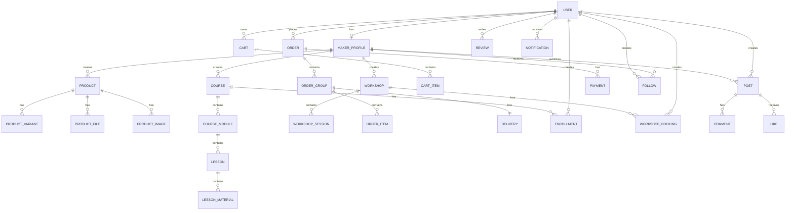
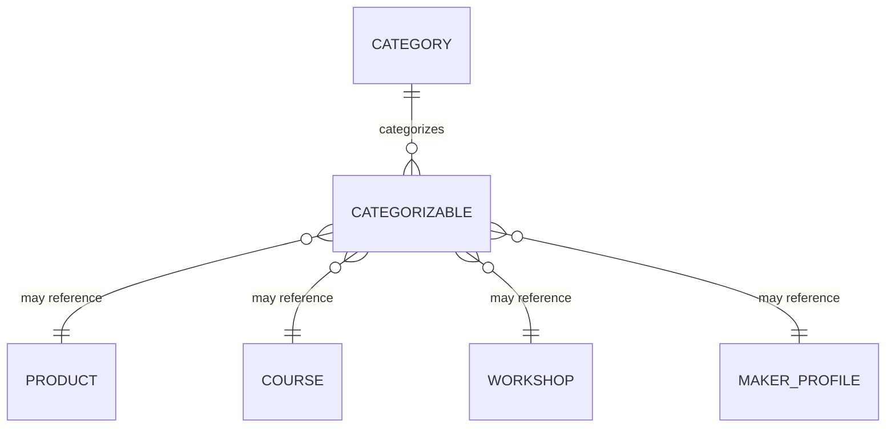

# Craft Woman — Entity Relationship Diagram

## 1. Purpose

This document defines the conceptual and logical Entity Relationship Diagram (ERD) for the Craft Woman platform.

The ERD translates the approved domain model into a relational structure and serves as the foundation for the PostgreSQL schema.

This document focuses on:

* entity relationships;
* cardinality;
* ownership;
* aggregate boundaries;
* cross-module relationships;
* polymorphic relationships;
* historical data requirements;
* inventory;
* orders and payments;
* course and workshop structures;
* community relationships.

This is a logical ERD. Exact PostgreSQL column types, indexes, constraints, defaults, and migration details are defined separately in:

`docs/03-domain/postgresql-schema.md`

---

# 2. Core Design Decisions

The following decisions are considered approved for the current version of the ERD.

### 2.1 Users and Makers

A Maker is a user who has an approved Maker profile.

A Maker is not a separate user type or separate identity.

A user can simultaneously act as:

* Customer;
* Maker;
* Administrator, where authorized.

Therefore:

```text
User
 ├── Customer capabilities
 └── MakerProfile
```

`MakerProfile` belongs to `User`.

---

### 2.2 Product Inventory

Inventory always belongs to `ProductVariant`.

`Product` does not contain a stock quantity.

Every physical product has at least one variant.

For a product without meaningful variants, a default variant is created.

Example:

```text
Product: Handmade Candle
    └── ProductVariant: Default
            └── stock = 25
```

For a product with variants:

```text
Product: Handmade T-Shirt
    ├── ProductVariant: Size S
    │      └── stock = 3
    ├── ProductVariant: Size M
    │      └── stock = 7
    └── ProductVariant: Size L
           └── stock = 2
```

Digital products do not require inventory.

---

### 2.3 Workshops

A `Workshop` is one purchasable/bookable event.

A workshop may contain multiple sessions.

A customer books the entire Workshop, not an individual session.

```text
Workshop
 ├── WorkshopSession
 ├── WorkshopSession
 └── WorkshopSession

WorkshopBooking
 └── Workshop
```

Sessions represent the schedule of the workshop.

Session capacity is used when validating workshop bookings.

---

### 2.4 Categories

Categories use a polymorphic relationship.

A single category can be associated with different categorizable entities such as:

* Products;
* Courses;
* Workshops;
* Makers.

Conceptually:

```text
Category
    │
    └── Categorizable
          ├── Product
          ├── Course
          ├── Workshop
          └── MakerProfile
```

The relational implementation uses:

```text
categories
categorizables
```

with:

* `category_id`
* `categorizable_type`
* `categorizable_id`

This avoids separate category pivot tables for every supported entity.

---

### 2.5 Payments

An Order can have multiple Payment records.

```text
Order 1 ─── N Payment
```

This supports payment retries, failed payment attempts, and a later successful payment.

Stripe-specific implementation details belong to the Payments module and must not leak into the Orders domain.

---

### 2.6 Order Structure

A cart may contain products from multiple Makers.

Checkout creates one top-level Order.

The Order contains one OrderGroup per Maker.

Each OrderGroup has its own Delivery.

```text
Order
 ├── OrderGroup — Maker A
 │    ├── OrderItems
 │    └── Delivery
 │
 ├── OrderGroup — Maker B
 │    ├── OrderItems
 │    └── Delivery
 │
 └── OrderGroup — Maker C
      ├── OrderItems
      └── Delivery
```

---

### 2.7 Currency

A Cart and Order use exactly one currency.

Supported currencies for the current scope:

* EUR
* USD
* UAH

The selected currency is also used for delivery amounts within the Order.

A single Order cannot contain multiple currencies.

---

# 3. Module-Level ERD



---

# 4. Identity Module

## 4.1 User

`User` represents an authenticated platform account.

A Guest is not stored as a User.

A Customer is an authenticated user with purchasing/participation capabilities.

A Maker is represented by an associated MakerProfile.

### Relationship

```text
User 1 ─── 0..1 MakerProfile
```

A user may have no MakerProfile or one MakerProfile.

---

## 4.2 Maker Profile

`MakerProfile` represents the public-facing identity of a Maker.

It contains information such as:

* display name;
* description;
* story;
* profile image;
* location;
* approval status;
* follow setting.

### Relationships

```text
User 1 ─── 0..1 MakerProfile

MakerProfile 1 ─── N Product
MakerProfile 1 ─── N Course
MakerProfile 1 ─── N Workshop
MakerProfile 1 ─── N Post
```

A Maker must be approved before receiving full Maker capabilities and publishing applicable content.

---

# 5. Marketplace Module

## 5.1 Product

`Product` represents a physical or digital product offered by a Maker.

Product types:

* physical;
* digital.

A Product belongs to exactly one Maker.

```text
MakerProfile 1 ─── N Product
```

A Product may have:

* variants;
* images;
* files;
* categories;
* tags.

---

## 5.2 Product Variant

`ProductVariant` represents a purchasable inventory unit of a Product.

Every physical Product has at least one ProductVariant.

The variant owns inventory.

```text
Product 1 ─── N ProductVariant
```

Examples of variant attributes:

* size;
* color;
* material;
* other Maker-defined attributes.

Variant-specific attributes may be stored as structured data where appropriate.

---

## 5.3 Product Image

A Product may have multiple images.

```text
Product 1 ─── N ProductImage
```

Images belong to the Marketplace module.

---

## 5.4 Product File

Digital Products may have one or more downloadable files.

```text
Product 1 ─── N ProductFile
```

The database stores metadata and storage references rather than binary file contents.

Actual file storage is handled by infrastructure/object storage.

---

## 5.5 Categories

Categories are managed by Administrators.

Categories support a polymorphic relationship with categorizable entities.

```text
Category 1 ─── N Categorizable
```

Supported categorizable entities include:

* Product;
* Course;
* Workshop;
* MakerProfile.

Relationally:

```text
categories
    id

categorizables
    category_id
    categorizable_type
    categorizable_id
```

A Product, Course, Workshop, or MakerProfile may belong to multiple categories.

A Category may be hierarchical through an optional self-reference:

```text
Category 1 ─── N Category
```

where a category may have a parent category.

---

## 5.6 Tags

Tags are managed by Administrators.

For the current MVP, tags are primarily associated with Products.

```text
Product N ─── N Tag
```

The relationship is represented by a pivot table.

The model can later be extended to other content types if needed.

---

## 5.7 Favorites

Customers can favorite Products.

```text
User 1 ─── N Favorite
Product 1 ─── N Favorite
```

A user may favorite a particular product only once.

The same pattern can later be extended to Makers, Courses, or Workshops without changing the core concept.

---

# 6. Education Module

## 6.1 Course

A Course is a purchasable educational product created by a Maker.

```text
MakerProfile 1 ─── N Course
```

A Course has:

* price;
* currency;
* access policy;
* status;
* modules;
* categories.

---

## 6.2 Course Module

A Course contains ordered Modules.

```text
Course 1 ─── N CourseModule
```

Modules belong to exactly one Course.

---

## 6.3 Lesson

A CourseModule contains ordered Lessons.

```text
CourseModule 1 ─── N Lesson
```

A Lesson can contain multiple materials.

---

## 6.4 Lesson Material

`LessonMaterial` represents the actual educational content of a Lesson.

Supported MVP material types include:

* text;
* video;
* file.

A Lesson may contain multiple materials.

```text
Lesson 1 ─── N LessonMaterial
```

Each material can define whether it is required for lesson/course completion.

---

## 6.5 Enrollment

An Enrollment represents a user's access to a Course.

```text
User 1 ─── N Enrollment
Course 1 ─── N Enrollment
```

There can be only one active/historical enrollment record for a given User + Course combination unless a future business rule explicitly introduces re-purchases/re-enrollments.

Enrollment stores access information such as:

* started at;
* expires at;
* status;
* completion state.

---

## 6.6 Lesson Progress

Progress belongs to an Enrollment.

```text
Enrollment 1 ─── N LessonProgress
Lesson 1 ─── N LessonProgress
```

A progress record represents the user's progress through a specific lesson.

---

## 6.7 Lesson Material Progress

Because a Lesson may contain multiple required materials, material-level progress is also supported.

```text
Enrollment 1 ─── N LessonMaterialProgress
LessonMaterial 1 ─── N LessonMaterialProgress
```

This allows completion rules such as:

* text → completed after reaching the end;
* video → completed after watching to the end;
* file → completed after opening/accessing it.

Lesson completion can then be derived from the completion of its required materials.

---

## 6.8 Certificate

A Certificate belongs to an Enrollment.

```text
Enrollment 1 ─── 0..1 Certificate
```

A certificate can only be issued when:

1. the Course enables certificates;
2. all required course materials are completed.

---

# 7. Workshops Module

## 7.1 Workshop

A Workshop is one purchasable/bookable event.

```text
MakerProfile 1 ─── N Workshop
```

A Workshop may contain multiple sessions.

---

## 7.2 Workshop Session

A WorkshopSession represents one scheduled part of a Workshop.

```text
Workshop 1 ─── N WorkshopSession
```

Each session contains:

* start/end date and time;
* capacity;
* online/offline mode;
* online meeting URL where applicable;
* physical location where applicable.

---

## 7.3 Workshop Booking

A WorkshopBooking represents a customer's booking for the entire Workshop.

```text
User 1 ─── N WorkshopBooking
Workshop 1 ─── N WorkshopBooking
```

The booking does **not** point directly to a WorkshopSession.

Example:

```text
Workshop
 ├── Session 1
 ├── Session 2
 └── Session 3

WorkshopBooking
 └── Workshop
```

A confirmed booking consumes capacity for the applicable sessions.

The application layer is responsible for validating that the booking does not exceed session capacity.

---

# 8. Orders Module

## 8.1 Cart

A Cart belongs to a Customer.

```text
User 1 ─── N Cart
```

Only one active cart is expected per Customer.

A Cart contains products from potentially multiple Makers.

A Cart uses exactly one currency.

---

## 8.2 Cart Item

A Cart contains CartItems.

```text
Cart 1 ─── N CartItem
```

A CartItem references:

* Product;
* ProductVariant where applicable;
* quantity;
* current purchase information.

The final price must be revalidated during checkout.

---

# 9. Order Structure

## 9.1 Order

An Order represents one checkout transaction.

```text
User 1 ─── N Order
```

One Order can contain products from multiple Makers.

An Order uses exactly one currency.

---

## 9.2 Order Group

An Order is divided into OrderGroups.

```text
Order 1 ─── N OrderGroup
```

There is one OrderGroup per Maker represented in the Order.

Example:

```text
Order #1001
│
├── OrderGroup — Maker A
│   ├── OrderItem
│   ├── OrderItem
│   └── Delivery
│
├── OrderGroup — Maker B
│   ├── OrderItem
│   └── Delivery
│
└── OrderGroup — Maker C
    ├── OrderItem
    ├── OrderItem
    └── Delivery
```

---

## 9.3 Order Item

An OrderGroup contains OrderItems.

```text
OrderGroup 1 ─── N OrderItem
```

An OrderItem references the purchased Product and ProductVariant.

The OrderItem stores a purchase-time snapshot.

The snapshot protects historical order information from later changes to:

* product name;
* variant name;
* price;
* selected attributes;
* other relevant product information.

Order history must remain stable even if the original Product is later edited or archived.

---

## 9.4 Delivery

Each OrderGroup has one Delivery record.

```text
OrderGroup 1 ─── 1 Delivery
```

This is required because different Makers may fulfill different parts of the same Order.

Delivery contains the delivery information and address snapshot applicable to that Maker's group.

Delivery currency is the same as the Order currency.

Each Maker sets a flat delivery fee per Order Group (domestic and, optionally, international) in their Maker profile.

Payment on delivery is supported under the rules in domain-rules.md §27.

---

# 10. Payments Module

## 10.1 Payment

An Order may have multiple Payment records.

```text
Order 1 ─── N Payment
```

Example:

```text
Order
 ├── Payment #1 — failed
 ├── Payment #2 — failed
 └── Payment #3 — succeeded
```

A Payment contains information such as:

* amount;
* currency;
* provider;
* provider payment identifier;
* status;
* timestamps.

The Orders module does not contain Stripe-specific logic.

Stripe integration belongs to the Payments module.

---

## 10.2 Payment Webhook Events

Payment provider webhook events must be processed idempotently.

Conceptually:

```text
PaymentProvider
      │
      └── Webhook Event
              ↓
      PaymentWebhookEvent
```

A provider event identifier must be unique within the provider context.

This prevents the same webhook from being processed multiple times.

---

# 11. Reviews Module

## 11.1 Review

A User can create a Review for an eligible target.

Supported targets:

* Product;
* Course;
* Workshop.

```text
User 1 ─── N Review

Review ─── Product
Review ─── Course
Review ─── Workshop
```

A Review has exactly one target.

Conceptually:

```text
Review
 ├── product_id
 ├── course_id
 └── workshop_id
```

Exactly one of these target references is populated.

This is preferred over an unrestricted polymorphic review target because the supported review targets are known and should have database-level referential integrity.

---

## 11.2 Review Eligibility

Eligibility is determined by the application/domain layer.

Examples:

* Product → user must have purchased the product;
* Course → user must have enrolled/purchased the course;
* Workshop → user must have a valid booking.

The database stores the review and target relationship but does not attempt to encode the complete purchase eligibility rule.

---

## 11.3 Review Uniqueness

A user may leave only one review for a specific target.

Therefore:

```text
User + Product = max 1 Review
User + Course = max 1 Review
User + Workshop = max 1 Review
```

This is enforced through database uniqueness constraints/indexes.

---

## 11.4 Maker Rating

Maker rating is derived from approved reviews of the Maker's Products.

It is not manually entered by the Maker.

Conceptually:

```text
Maker
   │
   └── Products
          │
          └── Reviews
                 │
                 └── AVG(rating)
```

Course and Workshop reviews do not contribute to the Maker rating in the current MVP.

A separate persisted MakerRating table is not required for the initial implementation.

A cached value can be introduced later if performance requires it.

---

# 12. Community Module

## 12.1 Post

A Maker can publish community Posts.

```text
MakerProfile 1 ─── N Post
```

A Post may contain:

* text;
* images/media;
* links;
* references to relevant Maker content.

---

## 12.2 Comments

Users can comment on Posts.

```text
Post 1 ─── N Comment
User 1 ─── N Comment
```

The MVP uses a simple comment structure.

Nested comment trees are not required.

---

## 12.3 Likes

Users can like Posts.

```text
User 1 ─── N Like
Post 1 ─── N Like
```

A user can like a particular Post only once.

---

## 12.4 Follows

Users can follow Makers when the Maker has enabled following.

```text
User 1 ─── N Follow
MakerProfile 1 ─── N Follow
```

Uniqueness:

```text
User + MakerProfile = max 1 Follow
```

The Maker controls whether the Follow feature is enabled.

---

# 13. Notifications Module

## 13.1 Notification

Notifications belong to Users.

```text
User 1 ─── N Notification
```

MVP delivery channel:

* Email.

Notifications may be related to events such as:

* order creation;
* successful payment;
* failed payment;
* shipment;
* delivery;
* course purchase;
* workshop booking;
* workshop reminder;
* review;
* follower;
* community content.

Order-related Customer notifications are mandatory.

Other notification types may be disabled according to the user's notification preferences.

---

## 13.2 Notification Preference

A User may have notification preferences.

```text
User 1 ─── N NotificationPreference
```

Each preference represents one configurable notification type.

Mandatory transactional order notifications are not controlled by optional notification preferences.

---

# 14. Taxonomy Relationships

The current taxonomy design uses a polymorphic `categorizables` table.



Logical representation:

```text
categories
------------
id
name
slug
parent_id

categorizables
--------------
category_id
categorizable_type
categorizable_id
```

The application layer controls which entity types are allowed to use categories.

---

# 15. Aggregate Boundaries

The ERD does not imply that all related records belong to one aggregate.

The following aggregate boundaries are recommended.

## Identity

```text
User
└── MakerProfile
```

MakerProfile may be treated as a separate aggregate owned by the same module if its lifecycle requires independent application operations.

---

## Marketplace

```text
Product
├── ProductVariant
├── ProductImage
└── ProductFile
```

Product owns its variants and product-specific media.

Category and Tag relationships are external associations.

---

## Education

```text
Course
└── CourseModule
     └── Lesson
          └── LessonMaterial
```

Enrollment is a separate aggregate.

Progress is owned by Enrollment.

Certificate belongs to Enrollment.

---

## Workshops

```text
Workshop
└── WorkshopSession
```

WorkshopBooking is a separate aggregate.

---

## Orders

```text
Cart
└── CartItem
```

and:

```text
Order
└── OrderGroup
     ├── OrderItem
     └── Delivery
```

Order is the transactional checkout aggregate.

---

## Payments

```text
Payment
```

Payment is its own aggregate.

Provider webhook events are idempotency/integration records.

---

## Reviews

```text
Review
```

Review is its own aggregate.

Maker rating is derived from Review data.

---

## Community

```text
Post
├── Comment
└── Like
```

Follow is a separate relationship/aggregate.

---

## Notifications

```text
Notification
NotificationPreference
```

These are separate notification concerns.

---

# 16. Cross-Module Relationships

Cross-module relationships are allowed at the persistence level where they are required for data integrity.

They do **not** mean that one module may directly manipulate another module's Eloquent models.

Examples:

```text
Orders → Identity
Orders → Marketplace

Education → Identity
Education → Orders

Workshops → Identity
Workshops → Orders

Reviews → Identity
Reviews → Marketplace
Reviews → Education
Reviews → Workshops

Community → Identity

Notifications → Domain Events
```

Application services and domain events are preferred for cross-module business workflows.

---

# 17. Historical Data

Orders must preserve historical purchase information.

Therefore `OrderItem` stores purchase-time snapshots instead of relying exclusively on current Product data.

For example:

```text
Product
name = "Blue Ceramic Mug"
price = 25 EUR
```

may later become:

```text
Product
name = "Blue Ceramic Mug — Large"
price = 30 EUR
```

The previous OrderItem must still display:

```text
Blue Ceramic Mug
25 EUR
```

The Product therefore must not be physically deleted while historical order records depend on it.

Products should normally be archived/soft-deleted instead.

---

# 18. Inventory Integrity

Inventory belongs exclusively to ProductVariant.

```text
Product
    │
    └── ProductVariant
            └── stock
```

Important invariants:

* stock cannot be negative;
* stock changes must be concurrency-safe;
* checkout must revalidate availability;
* concurrent purchases must not oversell inventory;
* digital products do not consume physical inventory.

Inventory updates must occur inside an appropriate database transaction/locking strategy.

---

# 19. Currency Relationships

Currency is stored together with monetary values.

Conceptually:

```text
amount_minor
currency
```

Example:

```text
2500 EUR
```

represents:

```text
amount_minor = 2500
currency = EUR
```

The application uses a Money value object.

No floating-point database type is used for monetary amounts.

A Cart has one currency.

An Order has one currency.

All OrderGroups and Deliveries within that Order use the same currency.

---

# 20. Soft Deletion and Historical Records

Soft deletion/archive behavior is preferred for content that may appear in historical relationships.

Candidates include:

* Products;
* Courses;
* Workshops;
* Posts;
* Maker profiles where appropriate.

Transactional records should not be physically deleted:

* Orders;
* OrderGroups;
* OrderItems;
* Payments;
* Payment webhook events.

Reviews should normally use moderation status rather than physical deletion.

The exact soft-delete policy is finalized in the PostgreSQL schema and application layer.

---

# 21. Database-Level Integrity

The PostgreSQL implementation should enforce structural rules where practical.

Examples:

### Product Variant

```text
stock >= 0
```

### Money

```text
amount_minor >= 0
```

### Review

```text
rating BETWEEN 1 AND 5
```

Exactly one review target must be set.

### Favorites

```text
UNIQUE(user_id, product_id)
```

### Follows

```text
UNIQUE(user_id, maker_profile_id)
```

### Likes

```text
UNIQUE(user_id, post_id)
```

### Enrollment

```text
UNIQUE(user_id, course_id)
```

### Workshop Booking

```text
UNIQUE(user_id, workshop_id)
```

Additional state-transition rules remain application/domain responsibilities.

---

# 22. Polymorphic Relationships

The project uses polymorphism only where it provides meaningful value.

### Approved polymorphic relationship

Categories:

```text
Category
    ↓
Categorizable
    ↓
Product / Course / Workshop / MakerProfile
```

### Relationships intentionally kept explicit

Reviews use explicit nullable target foreign keys rather than an unrestricted polymorphic relation because the set of reviewable entities is known:

```text
product_id
course_id
workshop_id
```

This provides stronger database-level referential integrity.

---

# 23. Search and Filtering

Search is not represented as a separate business entity.

Search operates over existing entities:

* Products;
* Makers;
* Courses;
* Workshops;
* Community content.

Potential filters include:

* category;
* price;
* Maker;
* rating;
* location;
* online/offline;
* date;
* product type;
* availability.

PostgreSQL indexes and full-text search structures are implementation concerns and are defined in:

`docs/03-domain/postgresql-schema.md`

Advanced search infrastructure may be introduced later without changing the core domain model.

---

# 24. Ownership Map

| Entity                 | Owning Module |
| ---------------------- | ------------- |
| User                   | Identity      |
| MakerProfile           | Identity      |
| Product                | Marketplace   |
| ProductVariant         | Marketplace   |
| ProductImage           | Marketplace   |
| ProductFile            | Marketplace   |
| Category               | Marketplace   |
| Tag                    | Marketplace   |
| Favorite               | Marketplace   |
| Course                 | Education     |
| CourseModule           | Education     |
| Lesson                 | Education     |
| LessonMaterial         | Education     |
| Enrollment             | Education     |
| LessonProgress         | Education     |
| LessonMaterialProgress | Education     |
| Certificate            | Education     |
| Workshop               | Workshops     |
| WorkshopSession        | Workshops     |
| WorkshopBooking        | Workshops     |
| Cart                   | Orders        |
| CartItem               | Orders        |
| Order                  | Orders        |
| OrderGroup             | Orders        |
| OrderItem              | Orders        |
| Delivery               | Orders        |
| Payment                | Payments      |
| PaymentWebhookEvent    | Payments      |
| Review                 | Reviews       |
| Post                   | Community     |
| Comment                | Community     |
| Like                   | Community     |
| Follow                 | Community     |
| Notification           | Notifications |
| NotificationPreference | Notifications |

Administration owns none of these business entities.

Administration manages them through application interfaces and authorization policies.

---

# 25. Relationship Summary

## Identity

```text
User 1 ─── 0..1 MakerProfile
```

## Marketplace

```text
MakerProfile 1 ─── N Product

Product 1 ─── N ProductVariant
Product 1 ─── N ProductImage
Product 1 ─── N ProductFile

Product N ─── N Tag

Category N ─── N Categorizable
```

## Education

```text
MakerProfile 1 ─── N Course

Course 1 ─── N CourseModule
CourseModule 1 ─── N Lesson
Lesson 1 ─── N LessonMaterial

User N ─── N Course through Enrollment

Enrollment 1 ─── N LessonProgress
Enrollment 1 ─── N LessonMaterialProgress
Enrollment 1 ─── 0..1 Certificate
```

## Workshops

```text
MakerProfile 1 ─── N Workshop

Workshop 1 ─── N WorkshopSession

User N ─── N Workshop through WorkshopBooking
```

## Orders

```text
User 1 ─── N Cart
Cart 1 ─── N CartItem

User 1 ─── N Order
Order 1 ─── N OrderGroup
OrderGroup 1 ─── N OrderItem
OrderGroup 1 ─── 1 Delivery
```

## Payments

```text
Order 1 ─── N Payment
```

## Reviews

```text
User 1 ─── N Review

Review → Product
Review → Course
Review → Workshop
```

## Community

```text
MakerProfile 1 ─── N Post

Post 1 ─── N Comment
Post 1 ─── N Like

User N ─── N Post through Like
User N ─── N MakerProfile through Follow
```

## Notifications

```text
User 1 ─── N Notification
User 1 ─── N NotificationPreference
```

---

# 26. ERD Scope

This ERD covers the current MVP domain.

Included:

* authentication/accounts;
* Maker profiles;
* physical products;
* digital products;
* ProductVariants and inventory;
* product media/files;
* categories and tags;
* favorites;
* courses;
* modules;
* lessons;
* lesson materials;
* course enrollment;
* progress tracking;
* certificates;
* workshops;
* workshop sessions;
* workshop bookings;
* cart;
* multi-Maker orders;
* OrderGroups;
* OrderItems;
* deliveries;
* online payments;
* payment retries;
* Stripe webhook idempotency;
* reviews;
* Maker product rating;
* community posts;
* comments;
* likes;
* Maker follows;
* email notifications;
* notification preferences.

---

# 27. Explicitly Deferred

The following are outside the current ERD scope or intentionally deferred:

* full refund workflows;
* shipping provider integrations;
* hosted video infrastructure;
* private messaging;
* advanced social feed algorithms;
* recommendation engine;
* advanced analytics;
* advanced search infrastructure;
* mobile application;
* additional payment providers;
* additional currencies;
* bundles;
* subscriptions;
* coupons;
* loyalty systems;
* advanced seller payouts;
* tax calculation;
* sophisticated community features.

These features may introduce additional entities later.

They should not be added to the MVP schema prematurely.

---

# 28. Implementation Notes

The ERD is intentionally independent of Laravel implementation details.

Laravel models, migrations, repositories, application services, and API resources must follow the ownership and relationship rules defined here.

The database will use PostgreSQL as the primary persistence layer.

The modular monolith uses one PostgreSQL database.

Logical module ownership is maintained through:

* aggregate boundaries;
* module interfaces;
* application services;
* domain events;
* authorization policies.

A database relationship does not grant another module permission to manipulate an entity directly.

---

# 29. Next Step

Before writing Laravel migrations, this ERD must be translated into the concrete PostgreSQL schema.

The next document is:

```text
docs/03-domain/postgresql-schema.md
```

It will define:

* exact tables;
* exact columns;
* PostgreSQL data types;
* primary keys;
* foreign keys;
* unique constraints;
* check constraints;
* indexes;
* nullable/non-nullable fields;
* soft-delete fields;
* timestamp strategy;
* delete behavior;
* monetary representation;
* UUID strategy;
* polymorphic relationship storage;
* migration dependency order.

No Laravel migrations should be created until the PostgreSQL schema has been reviewed and approved.
